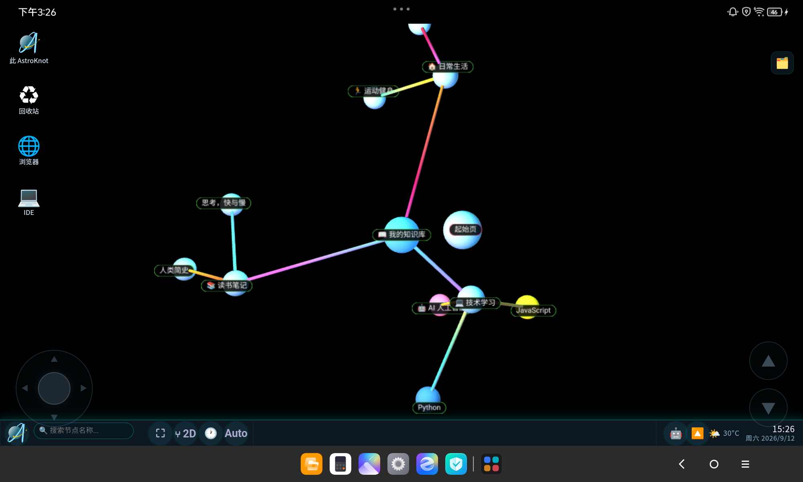
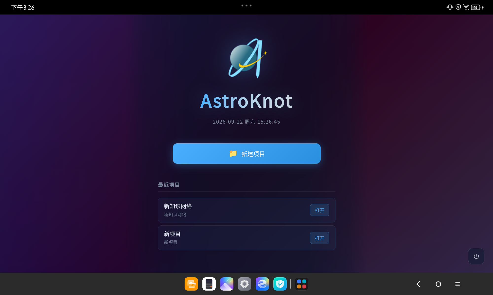
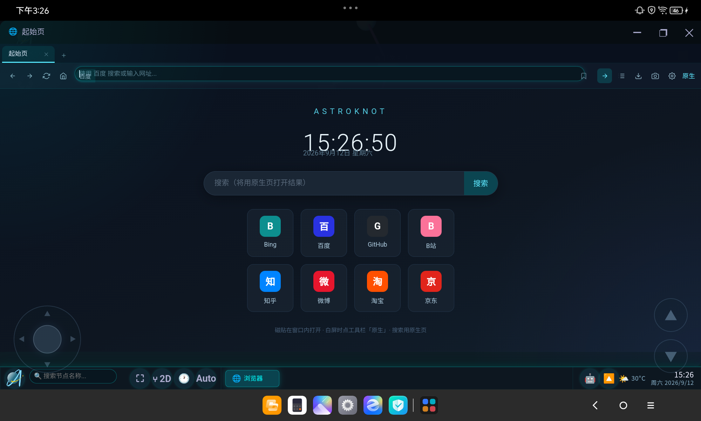

# ⚠️ 重要声明

本项目为个人业余 AI 辅助开发项目，是 [AstroKnot](https://github.com/) 桌面版的 **Android 平板移植版**，主要目的为探索"桌面级知识管理平台在平板触控设备上的完整可用性"。

- 项目**可运行**，但可能存在未知问题或边界情况
- **深度使用**或用于**商业生产环境**时，请自行评估风险
- 欢迎 fork、修改、提 PR，但不承诺提供长期维护支持

> 你已被充分告知。:)

# AstroKnot-Tablet


[](LICENSE)
[](https://capacitorjs.com/)
[]()

## 产品定位

AstroKnot-Tablet 将桌面版 AstroKnot（3D 知识图谱 + 分布式 IDE + 内置浏览器 + 日历排班）完整搬到 Android 平板上：**Web 渲染层复用桌面版全部代码**，通过"合成 + 裁剪 + 垫片"三层适配，在不修改桌面版一行源码的前提下，实现触控交互、文件化存储、窗口化应用与原生能力桥接。

- **与桌面版平级**的完整功能版（应用显示名就叫「AstroKnot」，无后缀）
- 数据与桌面版**同构**：`AstroKnot-Data/` 目录布局一致，可直接互拷迁移
- 桌面源码**永远零改动**——所有平板适配都隔离在本仓库内



## 核心架构：三层适配

```
┌─────────────────────────────────────────────────────┐
│  Android 原生层                                      │
│  StoragePermPlugin（存储权限/退出/打开位置/应用内打开）│
│  BrowserActivity（全屏原生浏览器页）                  │
│  MainActivity（长按链接桥 → 右键菜单）                │
├─────────────────────────────────────────────────────┤
│  垫片层 patches/js/（WebView 内运行的适配代码）        │
│  文件化存储 / IDE 文件系统 / 触控手势 / 浏览器适配     │
│  桌面图标触控 / GitHub 导入 / 虚拟摇杆 / 版本图…      │
├─────────────────────────────────────────────────────┤
│  合成层 www/（sync-web.mjs 生成，禁止手改）            │
│  桌面 web_version 的 head（本地化库）                 │
│  + 桌面版 index.html 的 body（最新 DOM）             │
│  + TRIM_PATCHES 对桌面模块的精准裁剪补丁              │
└─────────────────────────────────────────────────────┘
```

**构建流程**（每次改补丁/垫片后必须完整走一遍）：

```bash
node scripts/sync-web.mjs     # 1. 从桌面版合成 www/（含裁剪补丁 + 垫片注入）
npx cap copy android          # 2. 拷贝到 Android 工程（必须在项目根目录跑）
cd android && .\gradlew installDebug   # 3. 构建并安装到真机
```

## 特性

### 知识图谱核心（与桌面版一致）



- **2D/3D 双视图** — 3D 星图 + 2D 思维导图自由切换，多图层管理
- **富文本编辑器** — TinyMCE 7 完整功能，**全资源本地化，离线可用**
- **代码沙盒 IDE** — Monaco Editor + 文件树 + esbuild-wasm 打包 + 实时预览
- **版本控制** — 类 Git DAG 版本图，提交/分支/回滚，版本历史落盘 `.versiongraph/`（与桌面版同构，可直接互拷）
- **AI 对话** — Chat/Agent 双模式（需自配模型 API）
- **日历排班** — 月/周/日三视图、农历节气、排班、纪念日（lunar-javascript 已本地化）
- **日记 / 快速笔记** — 增删改实时落盘（`diaries/`、`quicknotes/`，与桌面版目录结构一致）

### 平板专属适配

- **全触控手势** — 3D 长按弹右键菜单 / 双击进编辑器 / 单击选中；2D 双指捏合缩放；卡片滚动、拖拽全部可用
- **虚拟摇杆** — 左摇杆模拟 WASD（3D 相机/2D 平移），右侧升降按钮（空格/Ctrl）
- **桌面图标模式** — 平板默认 Windows 桌面式图标网格（一格一个不重叠、碰撞吸附、拖动换位），左缘点按呼出应用库侧边栏
- **窗口化应用** — IDE、浏览器、文件管理器、回收站均以桌面式窗口运行（标题栏/最小化/最大化/关闭、可拖动）
- **文件化存储** — 项目/设置/回收站/日记/快速笔记/版本历史全部落盘到公共 `Documents/AstroKnot-Data/`，与桌面版目录结构完全一致；未授权存储权限时自动降级应用私有目录
- **「此 AstroKnot」文件管理器 + 回收站** — 内置应用完整移植，「打开文件所在位置」应用内自动定位
- **窗口化浏览器** — 桌面同款浏览器窗口（多标签/地址栏/书签/历史/右键菜单/起始页），iframe 渲染 + 「原生」按钮兜底 + 全屏原生浏览器页
- **浏览器起始页** — 时钟 + 搜索框 + 常用网站磁贴，新建标签不再白屏
- **浏览器右键菜单** — 桌面同款 11 项菜单（长按触发），跨域链接经原生桥也可弹出
- **GitHub 应用导入** — 免 git 实现（GitHub REST API + 并发下载），平板无 git/Node 也能从 GitHub 导入应用
- **启动首页** — 每次启动显示（动态渐变背景 + 最近项目列表），点项目直接进入
- **真正退出** — 右上角电源按钮彻底退出应用（非退后台）



### 性能裁剪（平板 WebView 优化）

- 帧率锁 50fps；WebGL pixelRatio 上限 1.0
- 2D 模式跳过整条 3D 渲染管线；极简模式跳过 Bloom 后处理链
- 华丽 3D 模式已裁剪（银河纹理占位）——平板 WebView 生成纹理耗时 130s+ 且耗电过快

## 与桌面版的功能差异

| 功能 | 桌面版 | 平板版 |
|------|--------|--------|
| 知识图谱 / 富文本 / IDE / 版本图 / 日历 | ✅ | ✅ 完整（版本历史/日记/笔记均落盘同构） |
| 项目存储 | `AstroKnot-Data/` | ✅ 同构（Documents 目录，需授权） |
| 内置终端（node-pty） | ✅ | ❌ 平板无 Node（terminal 接口优雅降级） |
| IDE `npm install` | ✅ | ❌ 依赖不持久，纯 HTML/JS 项目可用 |
| 浏览器渲染引擎 | Electron `<webview>` | iframe 适配器（主流网站可能拒嵌 → 「原生」按钮兜底） |
| 浏览器暗色注入/快捷指令/课表导入/下载/截图 | ✅ | ❌ 依赖 Electron 注入能力 |
| GitHub 云同步 | ✅ | ⚠️ 部分可用（按需补接口） |
| 鼠标悬停交互 | ✅ | 触控合成等效（长按=右键，双击=双击） |

## 项目结构

```
AstroKnot-Tablet/
├── scripts/
│   ├── sync-web.mjs          # ★ 核心：从桌面版合成 www/（TRIM_PATCHES 裁剪 + 垫片注入）
│   ├── generate-launcher-icons.ps1  # 启动器图标生成（GDI+，手机/平板两项目全密度）
│   └── tests/                # 真机 CDP 测试/诊断脚本（从项目根目录运行）
│       ├── cdp-verify-storage.mjs           #   文件化存储全周期（37 项：迁移/键值/项目/回收站/IDE）
│       ├── cdp-verify-desktop-ui.mjs        #   桌面图标/侧边栏/网格排列（8 项）
│       ├── cdp-verify-drag-icon.mjs         #   图标长按拖动换位（6 项）
│       ├── cdp-verify-fm.mjs                #   「此 AstroKnot」/回收站应用（7 项）
│       ├── cdp-verify-github-import.mjs     #   GitHub 应用导入/更新/删除
│       ├── cdp-verify-browser-window.mjs    #   浏览器窗口化（iframe 适配器）
│       ├── cdp-verify-browser-home.mjs      #   浏览器起始页（6 项）
│       ├── cdp-verify-browser-ctxmenu.mjs   #   浏览器右键菜单（5 项）
│       ├── cdp-verify-browser-inapp.mjs     #   全屏原生浏览器页（3 项）
│       ├── cdp-verify-browser-tabs.mjs      #   浏览器多标签
│       ├── cdp-verify-browser-shim.mjs      #   浏览器外部打开垫片
│       ├── cdp-verify-mode-btn.mjs          #   2D/3D 切换按钮图标
│       ├── cdp-verify-offline-editor.mjs    #   离线富文本编辑器（飞行模式）
│       ├── cdp-verify-startpage.mjs         #   启动首页
│       ├── cdp-verify-startpage-noribbon.mjs #  启动首页（飘带移除回归）
│       ├── cdp-verify-joystick-modal.mjs    # 虚拟摇杆位置/模态隐藏（5 项）
│       ├── cdp-verify-2d-drag.mjs           # 2D 长按拖动节点/框选/捏合回归
│       ├── cdp-verify-guide-tablet.mjs      # 新手教程触控化文案（8 项）
│       ├── cdp-verify-guide-arrange.mjs     # 教程「自动排列」步骤点击兜底（5 项）
│       ├── cdp-verify-2d-group.mjs          # 2D 框选/群组/菜单全链路（11 项）
│       ├── cdp-diag*.mjs / cdp-perf.mjs / cdp-profile.mjs  # 诊断与性能采样
│       ├── cdp-debug-*.mjs / cdp-joystick.mjs / cdp-data.mjs / cdp-check-recent.mjs  # 专项调试
│       ├── cdp-readme-shots.mjs / cdp-shot-browser.mjs  # 截图工具
│       └── cdp-trigger-open.mjs             #   触发「打开文件所在位置」测试
├── patches/
│   └── js/                   # 垫片层（合成时注入 www/js/）
│       ├── tablet-boot.js    #   启动注入入口（index.html 垫片链第一个）
│       ├── fs-boot.js        #   存储启动编排：根解析/迁移/预载/降级/会话中授权升级
│       ├── fs-core.js        #   文件系统工具层（根解析/权限/基础原语）
│       ├── system-storage-fs.js  # systemStorage*Sync 接口（键值层文件化）
│       ├── project-fs-shim.js    # 项目文件化存储（projects//trash/ 全周期）
│       ├── ide-fs-shim.js    #   IDE 15 个 ide* 文件接口（Capacitor Filesystem 实现）
│       ├── fm-shim.js        #   文件管理器 8 个 fm* 接口
│       ├── open-location-shim.js # 「打开文件所在位置」应用内定位
│       ├── notes-fs-shim.js  #   日记/快速笔记文件层（diaries/ + quicknotes/，桌面同构）
│       ├── webview-shim.js   #   ★ Electron <webview> → iframe 适配器 + 浏览器起始页
│       ├── browser-shim.js   #   浏览器外部打开兜底 / 课表导入提示
│       ├── github-read-shim.js   # GitHub 导入（REST API 免 git）
│       ├── desktop-ui-touch.js   # 桌面图标/侧边栏触控合成
│       ├── touch-gestures.js #   3D/2D 触控手势（长按/双击/单击/捏合）
│       ├── virtual-joystick.js   # 虚拟摇杆（WASD/升降合成）
│       └── version-shim.js   #   版本图 7 个 version* IPC（文件层后端，.versiongraph/ 桌面同构）
├── assets/                   # README 图标与真机截图（icon.png / readme-*.png）
├── android/
│   └── app/src/main/java/com/astroknot/tablet/
│       ├── MainActivity.java     # 长按链接桥（HitTestResult → 右键菜单）
│       ├── StoragePermPlugin.java # 存储权限/exitApp/openPath/openInApp 原生插件
│       └── BrowserActivity.java  # 全屏原生浏览器页（多标签/书签/历史）
├── www/                      # 合成产物（sync-web.mjs 生成，禁止手改）
├── capacitor.config.json     # appId: com.astroknot.tablet
└── package.json
```

## 快速开始

**环境要求**：

- Node.js >= 18
- Android Studio（含 JDK 17：`D:\Android Studio\jbr`）与 Android SDK
- Android 平板真机（Android 11+，开启 USB 调试）

```powershell
# 1. 克隆本仓库与桌面版（桌面版路径在 sync-web.mjs 顶部常量配置）
git clone <本仓库>
# 桌面版 AstroKnot 需放在同级或配置路径

# 2. 安装依赖
npm install

# 3. 合成 + 拷贝 + 安装（完整链路，顺序不可乱）
node scripts/sync-web.mjs
npx cap copy android          # 必须在项目根目录跑！
cd android
.\gradlew installDebug        # JAVA_HOME 指向 Android Studio 自带 JBR
```

### 注意事项

- **`npx cap sync/copy` 必须在项目根目录执行**——在 `android/` 子目录跑会报 "android platform has not been added yet" 且静默跳过资源复制
- 改补丁后完整链路 = `sync-web.mjs` → `cap copy` → `gradlew installDebug` → 重启 app，缺一步都不生效
- Gradle 已配国内镜像（腾讯 gradle 发行包 + 阿里 maven）
- `sync-web.mjs` 有网络下载步骤（本地化 CDN 库），失败会静默——若 `cap copy` 报 "must contain an index.html"，重跑即可

## 真机调试

通过 ADB 端口转发 + Chrome DevTools Protocol 调试 WebView：

```powershell
# 连接设备后
adb shell pidof com.astroknot.tablet          # 拿 pid
adb forward tcp:9222 localabstract:webview_devtools_remote_<pid>
# Chrome 打开 chrome://inspect 或直接调 CDP（HTTP 127.0.0.1:9222）

# 运行自动化验证脚本（scripts/tests/ 下 30 个 cdp-verify-*.mjs，从项目根目录运行）
node scripts/tests/cdp-verify-storage.mjs           # 文件化存储全周期 37 项
node scripts/tests/cdp-verify-desktop-ui.mjs        # 桌面图标/侧边栏/网格 8 项
node scripts/tests/cdp-verify-drag-icon.mjs         # 图标长按拖动换位 6 项
node scripts/tests/cdp-verify-fm.mjs                # 文件管理器/回收站应用 7 项
node scripts/tests/cdp-verify-github-import.mjs     # GitHub 导入/更新/删除
node scripts/tests/cdp-verify-browser-window.mjs    # 浏览器窗口化（iframe 适配器）
node scripts/tests/cdp-verify-browser-home.mjs      # 浏览器起始页 6 项
node scripts/tests/cdp-verify-browser-ctxmenu.mjs   # 浏览器右键菜单 5 项
node scripts/tests/cdp-verify-browser-inapp.mjs     # 全屏原生浏览器页 3 项
node scripts/tests/cdp-verify-browser-tabs.mjs      # 浏览器多标签
node scripts/tests/cdp-verify-browser-shim.mjs      # 浏览器外部打开垫片
node scripts/tests/cdp-verify-mode-btn.mjs          # 2D/3D 切换按钮图标
node scripts/tests/cdp-verify-offline-editor.mjs    # 离线富文本编辑器（飞行模式）
node scripts/tests/cdp-verify-startpage.mjs         # 启动首页
node scripts/tests/cdp-verify-startpage-noribbon.mjs # 启动首页（飘带移除回归）
node scripts/tests/cdp-verify-joystick-modal.mjs    # 虚拟摇杆位置/模态隐藏 5 项
node scripts/tests/cdp-verify-2d-drag.mjs           # 2D 长按拖动节点/框选回归
node scripts/tests/cdp-verify-2d-group.mjs          # 2D 框选/群组/菜单全链路 11 项
node scripts/tests/cdp-verify-2d-blank-drag.mjs     # 2D 空白直接拖动框选 8 项
node scripts/tests/cdp-verify-3d-move-drag.mjs      # 3D 移动模式长按拖节点 12 项
node scripts/tests/cdp-verify-desksync.mjs          # 桌面同步（配对码模式）12 项
node scripts/tests/cdp-verify-version-readback.mjs  # 版本历史 .versiongraph/ 落盘与读回
node scripts/tests/cdp-verify-notes-fs.mjs          # 日记/快速笔记落盘同步（增删改 roundtrip）
node scripts/tests/cdp-verify-guide-tablet.mjs      # 新手教程触控化文案 8 项
node scripts/tests/cdp-verify-guide-arrange.mjs     # 教程「自动排列」步骤点击兜底 5 项
```

**调试经验**：

- 测试前必须**点亮屏幕**（`adb shell input keyevent KEYCODE_WAKEUP`）——熄屏时 WebView 节流，60ms 等待实际变 500ms+，自动化测试随机失败
- 原生控件断言用 `adb shell uiautomator dump` + 解析 bounds 后 `input tap`
- 真机报错先怀疑 APK 版本旧（CDP fetch 运行页面的 js 查补丁标记验证）
- 存储授权测试可用 `adb shell appops set com.astroknot.tablet MANAGE_EXTERNAL_STORAGE allow` 免 UI 授权

## 数据存储

```
/storage/emulated/0/Documents/AstroKnot-Data/   # 授权后（未授权降级 App 私有目录）
├── projects/<项目名>/project.json               # 项目（与桌面版同构）
│   └── .versiongraph/                           # 版本历史（graph.json + blobs/，桌面同构）
├── system/storage/*.json                        # 应用设置键值（每个 key 一个文件）
├── system/version-graphs-tmp/<项目id>/           # 未保存项目的版本图（桌面 userData 对应物）
├── diaries/<年-月>/<日期>.html                   # 日记（+ diary-index.json 索引）
├── quicknotes/quicknotes.json                   # 快速笔记清单（+ <安全名_id前8位>/ 笔记文件夹）
├── trash/<项目名>/.trash-meta.json              # 回收站
└── apps/<app-id>/vfs.json                       # GitHub 导入的应用
```

- 首次启动自动从 localStorage 迁移（localStorage 原样保留作备份，迁移标记 `astroknot_fs_migrated`；版本历史/快速笔记各有独立迁移，成功后清键）
- 会话中授权升级：退后台 → 授权 → 回前台自动切换到 Documents 并补迁移
- 任一步失败自动回退 localStorage 模式，不崩溃

## 触控手势对照

| 桌面操作 | 平板等效 |
|----------|----------|
| 单击 | 点按（≤550ms，位移 ≤12px） |
| 双击 | 双击（间隔 <300ms，落点 <30px） |
| 右键 | 长按 550ms（震动反馈） |
| 拖拽 | 按住拖动（图标另支持"长按后再拖"） |
| 滚轮缩放（2D） | 双指捏合（0.85–1.18 单步） |
| WASD/空格/Ctrl（3D 移动） | 虚拟摇杆 + 升降按钮 |

## License

MIT
